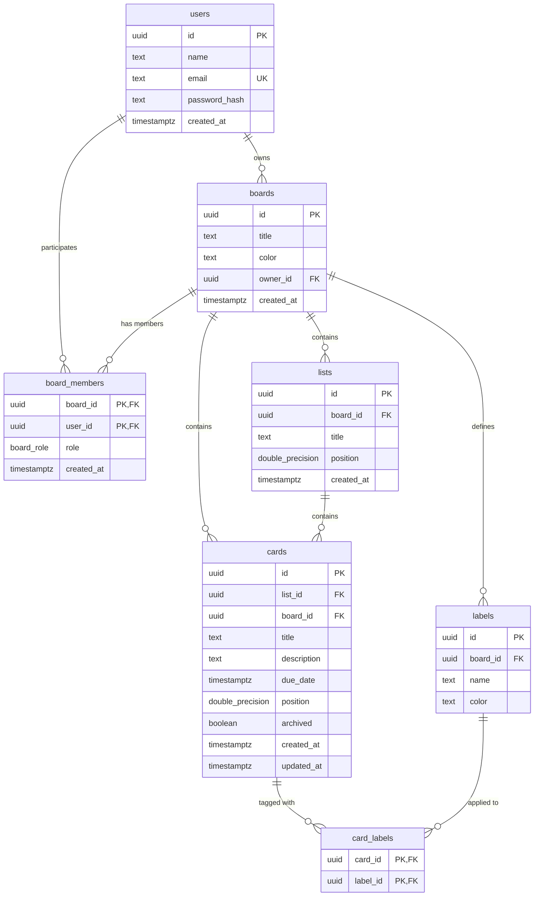

# Tackboard 📌
> An indie-crafted project management tool built with React, Node/Express, and PostgreSQL.

Tackboard is a fast, tactile, and resilient board management system featuring fractional index drag-and-drop, atomic list rebalancing, persistent httpOnly session authentication, and role-based access control (Owner, Member, Viewer).

---

## 🎨 Indie Studio Aesthetic & Design Philosophy
- **Tactile Paper Palette:** Warm off-white canvas (`#F4F1EA`), deep ink typography (`#1C1917`), subtle hairline borders (`1px solid #E2DCD2`), and a refined set of 8 desaturated earthy board accents.
- **Editorial Typography:** *Bricolage Grotesque* / *Instrument Sans* for dense, readable UI and *Fraunces* for editorial board titles.
- **Physical Drag Interactions:** Cards lift with subtle rotation (~2°), cast deep natural shadows, leave a dashed drop placeholder, and sibling cards slide with a 180ms ease.
- **Zero "AI Generic" Look:** No glowing neon purples, no glassmorphism or blurred backdrop noise, no emoji icons (clean 1.5-stroke Lucide vectors), and no generic placeholder cards.

---

## 🛠 Tech Stack
- **Frontend:** React 18 (Vite), React Router v6, `@dnd-kit/core` + `@dnd-kit/sortable`, Lucide icons, vanilla CSS with CSS variables.
- **Backend:** Node.js, Express, PostgreSQL via `pg` driver using **100% parameterized queries** (`$1`, `$2`), `node-pg-migrate` runner, JWT in secure `httpOnly` cookies, `bcryptjs`.
- **Drag-and-Drop:** Fractional indexing with midpoint calculations (`position` double precision) and automatic `O(1)` list rebalancing via `ROW_NUMBER() * 1000.0` when gap drops below 0.0001.

---

## 📐 Entity-Relationship Diagram (ERD)



---

## 🔒 Role-Based Access Control (RBAC)

| Role | Permissions | Forbidden Operations |
| :--- | :--- | :--- |
| **Owner** | Everything: create/edit/move/archive cards & lists, invite/remove members, change roles, rename & delete board. | Cannot demote or remove themselves as the primary owner. |
| **Member** | Create, edit, drag & reorder, archive cards; create, rename, delete, and reorder lists; invite collaborators. | Cannot delete board, cannot demote/remove owner. |
| **Viewer** | **Read-only access.** Can view board, lists, cards, members, and labels. | **Drag handles, add buttons, and edit fields are not rendered.** Server returns `403 Forbidden` on any write attempts. |

> **Security Note:** Attempting to read a board by an uninvited user returns `404 Not Found` (never 403) to prevent board ID enumeration.

---

## 🚦 API Route Table

### 1. Authentication (`/api/auth`)
| Method | Endpoint | Description | Auth Required |
| :--- | :--- | :--- | :--- |
| `POST` | `/api/auth/register` | Register a new user and set httpOnly cookie | None |
| `POST` | `/api/auth/login` | Login user, verify bcrypt hash, set httpOnly cookie | None |
| `POST` | `/api/auth/logout` | Clear session cookie | None |
| `GET` | `/api/auth/me` | Fetch authenticated user session | Session Cookie |

### 2. Boards (`/api/boards`)
| Method | Endpoint | Description | Minimum Role |
| :--- | :--- | :--- | :--- |
| `GET` | `/api/boards` | List all boards user is a member of | Authenticated |
| `POST` | `/api/boards` | Create a new board (creator becomes Owner) | Authenticated |
| `GET` | `/api/boards/:boardId` | Full board details (lists, cards, labels, members) | Viewer |
| `PATCH` | `/api/boards/:boardId` | Rename board or change color accent | Owner |
| `DELETE`| `/api/boards/:boardId` | Delete board and cascade delete all child items | Owner |
| `POST` | `/api/boards/:boardId/members` | Invite member by email (`viewer`, `member`, `owner`) | Owner |
| `PATCH` | `/api/boards/:boardId/members/:userId` | Update member role | Owner |
| `DELETE`| `/api/boards/:boardId/members/:userId` | Remove member from board | Member (Self) / Owner |

### 3. Lists (`/api/lists`)
| Method | Endpoint | Description | Minimum Role |
| :--- | :--- | :--- | :--- |
| `POST` | `/api/lists` | Create a list on a board | Member |
| `PATCH` | `/api/lists/:id` | Rename list or update position (fractional index) | Member |
| `DELETE`| `/api/lists/:id` | Delete list and cascade delete cards | Member |

### 4. Cards (`/api/cards`)
| Method | Endpoint | Description | Minimum Role |
| :--- | :--- | :--- | :--- |
| `POST` | `/api/cards` | Create a card in a list | Member |
| `GET` | `/api/cards/:id` | Get card detail modal data with labels | Viewer |
| `PATCH` | `/api/cards/:id` | Move card position / edit title, desc, due date, archive | Member |
| `POST` | `/api/cards/:id/labels` | Toggle label attachment on a card | Member |
| `DELETE`| `/api/cards/:id` | Delete card permanently | Member |

### 5. Labels & AI (`/api/labels`, `/api/ai`)
| Method | Endpoint | Description | Minimum Role |
| :--- | :--- | :--- | :--- |
| `POST` | `/api/labels` | Create custom label on board | Member |
| `PATCH` | `/api/labels/:id` | Rename label or change color | Member |
| `DELETE`| `/api/labels/:id` | Delete label from board | Member |
| `POST` | `/api/ai/summarize` | AI executive summary for card tasks (Gemini API) | Authenticated |

---

## ⚡ Setup & Quickstart

### Prerequisites
- Node.js (v18+)
- PostgreSQL (v14+) running locally

### 1. Database Setup
Ensure PostgreSQL is running and create the `tackboard` database:
```bash
createdb tackboard
```

### 2. Environment Variables
Copy the `.env.example` file in `/server`:
```bash
cd server
cp .env.example .env
```

Ensure your `.env` contains:
```env
PORT=5000
DATABASE_URL=postgresql://postgres@127.0.0.1:5433/tackboard
JWT_SECRET=tackboard_super_secret_jwt_key_indie_studio_349857
CLIENT_URL=http://localhost:5173
NODE_ENV=development
# Optional: GEMINI_API_KEY=your_key_here
```

### 3. Migrations & Seed Data
Run the SQL schema migration and populate realistic demo data:
```bash
# In the server folder:
npm install
npm run migrate:up
npm run seed
```

### 4. Start the Application
Run both servers:

**Terminal 1 (Backend):**
```bash
cd server
npm run dev
# Server runs on http://localhost:5000
```

**Terminal 2 (Frontend):**
```bash
cd client
npm install
npm run dev
# Client runs on http://localhost:5173
```

---

## 👥 Demo Logins

| Email | Password | Role on "Acme Mobile App" | Role on "Core API" |
| :--- | :--- | :--- | :--- |
| `alex@tackboard.dev` | `password123` | **Owner** (Full Control) | **Owner** (Full Control) |
| `sam@tackboard.dev` | `password123` | **Member** (Edit/Move Cards) | **Viewer** (Read-Only) |
| `jordan@tackboard.dev`| `password123` | **Viewer** (Read-Only) | **Member** (Edit/Move Cards) |

---

## ⌨️ Keyboard Shortcuts
- `n` : Quickly open "Add New Card" dialog on the first list.
- `/` : Focus search bar to filter cards across lists.
- `Esc` : Close any open modal or card side-panel.
- `?` : Open keyboard shortcut cheat sheet.

